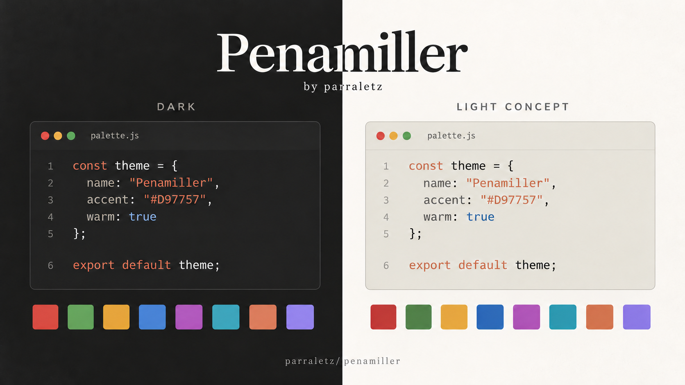

# Penamiller



> AI-generated concept preview. **Dark** reflects the current palette's visual
> identity; **Light Concept** is a design proposal, not an installable variant.
> All included ports are still dark. For exact colors, refer to `palette.json`
> rather than the illustration's pixels.

A dark color palette created by **aparra**, independent of personal dotfiles.
Repository: [parraletz/penamiller](https://github.com/parraletz/penamiller).

- Background: `#141413`; foreground: `#FAF9F5`; orange accent: `#D97757`.
- [`palette.json`](palette.json): the central palette, with 16 ANSI colors and eight accents.
- [`palette.schema.json`](palette.schema.json): JSON Schema 2020-12; the palette's
  relative reference allows validation without contacting a server.
- [`ports/`](ports/): themes and color configuration snippets, without personal settings.
- [`SOURCE.md`](SOURCE.md): provenance, extraction changes, and existing license declarations.

Ports are static files: changing the palette **does not regenerate them**.
Nothing is installed or activated automatically. Back up your files and merge
the snippets into your configuration rather than replacing entire config files.

## Installation by application

The paths below assume `~/.config`; adjust them if you use `XDG_CONFIG_HOME`.

| Application | Resource | Installation / activation |
| --- | --- | --- |
| Ghostty | `ports/ghostty/Penamiller` | Copy to `~/.config/ghostty/themes/Penamiller`; add `theme = Penamiller` to your configuration. |
| WezTerm | `ports/wezterm/penamiller.lua` | Copy next to `wezterm.lua`; use `config.colors = require("penamiller")` instead of the previous color scheme. |
| bat | `ports/bat/penamiller.tmTheme` | Copy to `$(bat --config-dir)/themes/`; run `bat cache --build` and select `--theme=penamiller`. |
| iTerm2 | `ports/iterm2/Penamiller.itermcolors` | Import through Settings → Profiles → Colors → Color Presets → Import. |
| Zed | `ports/zed/penamiller.json` | Copy to `~/.config/zed/themes/`; select `Penamiller`. |
| OpenCode | `ports/opencode/penamiller.json` | Copy to `~/.config/opencode/themes/`; select `penamiller` in your TUI's `theme` setting. |
| Zellij | `ports/zellij/penamiller.kdl` | Copy to `~/.config/zellij/themes/`; set `theme "penamiller"` in `config.kdl`. |
| Herdr | `ports/herdr/penamiller.toml` | Merge `[theme]` and `[theme.custom]` into `~/.config/herdr/config.toml` without duplicating tables. |
| fzf | `ports/fzf/penamiller.sh` | Load with `source /path/to/penamiller/ports/fzf/penamiller.sh` in your shell; existing fzf options are preserved. |
| Neovim / Catppuccin | `ports/nvim/penamiller.lua` | Merge the overrides into your Catppuccin options; see the example below. |
| Konsole | `ports/konsole/` | Copy the color scheme to `~/.local/share/konsole/`; select it in your profile's appearance settings. The included profile is optional. |
| KDE / Plasma | `ports/kde/` | Copy `color-schemes/` and the packages in `plasma/` to the corresponding paths under `~/.local/share/`; select them in System Settings. |
| GTK 3 / 4 | `ports/gtk-3.0/penamiller.css`, `ports/gtk-4.0/penamiller.css` | Copy each file to its respective `~/.config/gtk-3.0/` or `gtk-4.0/` directory; add `@import url("penamiller.css");` at the beginning of each `gtk.css`, preserving the remaining content. |

### Neovim

Requires `catppuccin/nvim`: this is a Catppuccin customization, not a standalone
color scheme. Copy the file to `~/.config/nvim/lua/penamiller.lua`.
With lazy.nvim, merge this snippet into your existing plugin specification:

```lua
{
  "catppuccin/nvim",
  name = "catppuccin",
  opts = function(_, opts)
    return vim.tbl_deep_extend("force", opts, require("penamiller"))
  end,
}
```

Select `catppuccin-mocha` as your color scheme; in LazyVim, set it through the
`LazyVim/LazyVim` options. Existing integrations remain unchanged.

### KDE and GTK

The Plasma style requires Breeze as a fallback. The GTK overrides were designed
on top of Breeze and may not cover applications that enforce their own styling.
The `com.parraletz.penamiller` Global Theme only applies the color scheme,
Plasma style, and Breeze widget style: it does not change your layout, icons,
cursor, desktop count, or effects. The original preview also shows personal
desktop preferences from the source setup, which are not included.

## Validation

Using Python 3.11 or later:

```sh
python3 -m venv .venv
.venv/bin/pip install -r requirements-dev.txt
.venv/bin/python -m unittest discover -s tests -v
```

The tests check the schema, invalid inputs, JSON/plist/TOML formats,
Ghostty ANSI palette consistency, and the Global Theme's visual-only settings.
They do not replace visual testing within each application.
